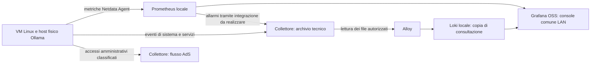

# Osservabilità Linux, host Ollama e integrazione dei log

Studio del 15/10/2026, richiesto dall’operatore mentre si attende la risposta Seeweb. Obiettivo: vedere le macchine Linux da una console comune, includere l’host fisico Ollama, conservarne gli eventi nel collettore e mantenere Windows nel presidio NinjaOne già indicato dall’operatore. L’operatore sceglie una soluzione locale e senza abbonamenti. Proposta conseguente: Netdata Agent per le metriche, Prometheus come raccolta centrale, Grafana OSS come console, Loki per la ricerca dei log tecnici tramite Alloy. Fattibilità documentale verificata; l’operatore ha scelto il fisico Ollama come primo pilota e restituito le letture iniziali e il dry-run riuscito. Agent 2.12.1 avviato dall’operatore sul pilota: servizio attivo, loopback e CPU/RAM locali verificati, ACLK non online. GPU locale verificata nel daemon il 16/10: utilizzo, frame buffer e temperatura con contatori 1/3/1. Impatto sostenuto, raccolta centrale, collocazione e dimensionamento dello stack ancora da collaudare; baseline Debian preparata. Baseline e procedura in [Runbook del pilota](runbook-monitoraggio-linux.md). Nella rete il lavoro è M32, collegato a M29 e ISO-30; nel collettore è ADR-020, coerente con ADR-019.

## Risultato e perimetro misurato

La documentazione conferma sia la gerarchia Children/Parent di Netdata, sia l’export delle metriche verso Prometheus. Per il requisito scelto, il punto comune è Grafana OSS: Prometheus acquisisce le metriche degli Agent e le rende consultabili dalla stessa UI che interroga Loki per i log tecnici. Un Parent Netdata è un’opzione successiva per aggregazione o collegamenti remoti, non un requisito del primo pilota. Lo streaming delle metriche non trasferisce automaticamente i journal degli ospiti al collettore.

Il conteggio iniziale usa lo snapshot Proxmox locale generato il 15/10/2026 alle 07:30:18: undici VM QEMU, dieci con `config.ostype=l26` e una Windows. Delle dieci configurate Linux, nove risultano running e una stopped; lo stato è quello dell’acquisizione, non una verifica live. `l26` è una dichiarazione dell’hypervisor, non la lettura della distribuzione o del sistema di init dell’ospite. Nessun container LXC nello snapshot. L’host fisico Ollama, già presente nella topologia e nel censimento host della rete, porta a undici candidati Linux iniziali, includendo il template spento; non è una VM aggiuntiva di Proxmox. I nomi e la corrispondenza con gli identificativi reali restano nell’inventario privato.

Non è un censimento esaustivo di Linux nel cloud o di apparati embedded. Proxmox, iLO e gli eventuali ospiti cloud mantengono il proprio perimetro; nuovi host Linux si aggiungono quando identificati. La vecchia descrizione applicativa di Ollama come VM non supera la ricognizione successiva che lo distingue come host fisico. L’agente non ha aperto connessioni SSH; l’operatore ha eseguito le letture dal proprio terminale già aperto, come registrato nel runbook. NinjaOne resta la scelta dichiarata per il monitoraggio Windows; la presenza dell’agent non dimostra copertura o ricezione nel collettore degli accessi amministrativi Windows.

## Dati e destinazioni

| Dati | Esempi | Destinazione proposta |
|---|---|---|
| Metriche | CPU, memoria, swap, disco, rete, processi; GPU, temperature e salute storage dove disponibili | Agent Netdata, raccolta Prometheus locale, consultazione Grafana OSS |
| Eventi tecnici | OOM, errori I/O, guasti dei servizi, riavvii, errori del driver GPU | Archivio tecnico del collettore; copia di consultazione Loki tramite Alloy, distinta dalla prova AdS |
| Accessi amministrativi | SSH riuscito/rifiutato, sudo, su, sessioni, secondo i campioni realmente disponibili | Flusso AdS già previsto, rispettandone gate, attribuzione e custodia |
| Transizioni degli allarmi | Apertura, variazione di gravità, rientro e indisponibilità della sorgente | Archivio tecnico, con sorgente e identificativo dell’allarme |

È una proposta di flussi, non una configurazione in esercizio. Il database delle metriche è un componente del monitoraggio; non converte ciascun campione in una riga della catena AdS e non cambia i tre archivi logici di ADR-019. Grafana offre datasource Prometheus e Loki: filtri per macchina e intervallo temporale devono correlare metriche e log della stessa sorgente. Loki conserva una copia per la consultazione, non sostituisce l’originale raccolto o la catena della prova. Nel pilota si indicizzano i file tecnici autorizzati; la consultazione AdS rimane soggetta al progetto del frontend e della custodia già aperto.

Per gli eventi originali la proposta interna è usare il sistema operativo come sorgente e un trasporto con coda persistente verso il ricevente. Rsyslog/TLS è già il percorso previsto per le VM, ma la configurazione corrente del collettore non va riutilizzata senza separare i ruleset: tutti i log di un nuovo host non devono finire per difetto nei file AdS. Occorrono classificazione, origine, ora dichiarata/ricevuta, code, quote, retention e controllo del silenzio. Alloy legge i file tecnici con i soli permessi necessari e conserva le posizioni di lettura nel proprio stato persistente; rotazione, riavvio, mancata consegna a Loki e riletture vanno collaudati, senza presumere una garanzia exactly-once dalle sole posizioni. Il punto di gestione degli allarmi va scelto per evitare duplicazione fra Netdata, Grafana e i presidi esistenti. Le notifiche Netdata custom sono una possibilità documentata, non un invio Syslog al collettore già pronto.

## Console, licenze e dipendenze

Il repository distingue Agent GPLv3+, UI proprietaria NCUL1 e servizio Cloud. La pagina prezzi consultata il 15/10 indica Community per uso personale non commerciale, massimo cinque nodi attivi; Business è il piano aziendale da valutare. Questo non vieta l’uso aziendale del core GPL: è la combinazione di UI, piano e funzioni richieste che richiede una scelta esplicita. Nessun account, acquisto o sottoscrizione effettuati.

Il riferimento dei controlli di accesso riporta cinque nodi per le viste gratuite e distingue questi limiti dalla capacità di streaming: un Parent può ricevere più nodi, ma riceverli non dimostra che la UI desiderata li mostri tutti. La stessa guida descrive differenze tra viste locali e Cloud; il comportamento esatto della release scelta va verificato nel pilota. Non si promette una console gratuita illimitata aggiungendo un Parent. Il conteggio commerciale non è automaticamente undici: Parent aggiuntivi e nodi spenti vanno valutati secondo il piano effettivo.

Il plugin dei journal richiede un account Netdata Cloud e una build compatibile; le funzioni sensibili seguono l’autenticazione Cloud. La UI di configurazione dinamica richiede un piano a pagamento. Il possesso dei dati su disco locale non equivale quindi a consultazione dei log senza account esterno. La licenza NCUL1 della UI è distinta dalle condizioni del piano Community. Per il requisito locale scelto si propone Grafana OSS con un backend Prometheus: l’export delle metriche Netdata e il datasource Grafana sono documentati. La ricerca dei file tecnici passa da Alloy/Loki; lettura e custodia dei file AdS restano nel progetto dedicato.

Scelta dell’operatore ricevuta il 15/10: locale e senza abbonamenti. La UI Netdata con funzioni Cloud non è quindi la console del progetto; si usa l’interoperabilità ufficiale del core Agent, con Grafana OSS, Prometheus, Loki e Alloy locali. Non si modifica la UI proprietaria. Grafana/Loki sono progetti OSS, con licenze da mantenere nei pacchetti distribuiti; l’uso interno proposto non richiede una sottoscrizione Cloud. Il funzionamento della soluzione resta da dimostrare sulla release scelta, includendo accesso ai dati con collegamenti Cloud disabilitati e telemetria degli Agent disattivata.

Per il pilota Prometheus legge gli Agent tramite l’endpoint documentato `/api/v1/allmetrics` in formato Prometheus, con identità e label stabili per host. Gli endpoint sono raggiungibili soltanto dai componenti autorizzati; Grafana è la UI LAN con autenticazione locale e TLS. Loki e Prometheus non sono portali pubblici. Un eventuale Parent esporta più host con modalità specifica: lo scrape locale predefinito non prova copertura di tutti i Children. Configurazioni, porte, credenziali e regole di rete rimangono da preparare sui valori reali.

## Hardware, Ollama e limiti della visibilità

Nelle VM si misurano le risorse virtuali e gli eventi dell’ospite. Ventole, alimentatori, temperature e dischi fisici richiedono una sorgente sul livello fisico: host, sensori esposti o controller di gestione. Il flusso iLO già esistente resta complementare. La disponibilità di un grafico disco in una VM non prova copertura SMART del disco dell’hypervisor.

Sul nodo fisico Ollama si devono leggere distribuzione/init, GPU e driver, sensori, dischi, servizi effettivi e modalità di avvio. Le integrazioni libsensors e NVIDIA sono documentate; NVIDIA usa `nvidia-smi`, quindi non basta il nome Ollama per assumere GPU, VRAM o temperature disponibili. Il monitoraggio del processo o della GPU non dimostra correttezza delle risposte del modello. Un controllo applicativo va progettato a parte, con costo e dati della prova concordati.

Ollama è associato nella documentazione di rete alla porta 46 del 54HP e a NET-010, un precedente link flap; questo è contesto storico, non un guasto rimisurato oggi. La ricognizione degli accessi e dei servizi di agosto non descrive automaticamente lo stato del 15/10. Le letture SSH e le installazioni su macchine reali seguono la conferma esplicita per comando prevista dal progetto.

## Collocazione e sequenza proposta

Lo snapshot attribuisce al collettore 2 GB di RAM e due core. Senza misura di memoria libera, I/O, spazio e volume non si aggiunge a questa VM la conservazione delle metriche di tutta la flotta. La proposta è dimensionare un hub Grafana/Prometheus/Loki separato, con accesso amministrativo dalla rete di gestione e collegamenti alle sorgenti ristretti. Alloy può leggere i file tecnici sul collettore con risorse e permessi misurati. Non viene creata una VM e non viene scelto un indirizzo. La richiesta di usare la VM esistente per i tre archivi dei log rimane valida; la collocazione dei database di consultazione è una proposta distinta da confermare dopo il dimensionamento.

M29 mantiene watchdog e presidi delle VM. Netdata aggiunge osservabilità: non sostituisce il watchdog né supera il gate già deciso per l’estensione delle sorgenti AdS dopo M29. Si può preparare questo studio mentre il gate rimane aperto. Anche il monitoraggio dell’hub e del collettore da una sorgente esterna va previsto, perché un hub fermo non può avvisare di sé stesso.

| Passo rete | Lavoro | Evidenza richiesta prima della chiusura |
|---|---|---|
| M32a | Ricognizione minima di un pilota Linux e del fisico Ollama, poi inventario degli altri ospiti | OS/init, architettura, risorse, journal persistente, servizi, GPU/sensori, stato di M29 e sorgenti originali verificati |
| M32b | Tradurre la scelta locale senza abbonamenti in configurazioni OSS e release riproducibili | Agent Netdata, Prometheus, Grafana OSS e Loki/Alloy; consultazione senza account Cloud e dipendenze runtime verificate |
| M32c | Dimensionare e proteggere l’hub | Misura di carico e spazio, retention, autenticazione e separazione dalla raccolta; piano di recupero e porte espliciti |
| M32d | Pilota sul fisico Ollama scelto dall’operatore, poi VM Linux | Prima/dopo CPU, RAM, disco e prestazioni del servizio; sorgenti identificabili e sensori realmente disponibili |
| M32e | Collegare eventi originali e allarmi al collettore, poi i soli file tecnici autorizzati a Loki | Campioni tecnici/AdS separati, orari, conteggi, duplicati, coda e recupero dopo interruzione; posizioni Alloy e ricerca Grafana provate |
| M32f | Estendere per piccoli gruppi e verificare la copertura | Una riga per host, ricezione e UI provate, silenzio/retention, macchina spenta distinta da sorgente non configurata e rollback |

Raccolta delle metriche e invio dei log sono collaudi diversi. Uno scrape Prometheus mancato non viene automaticamente recuperato dal journal o dallo storico Netdata: i buchi del percorso proposto vanno misurati e resi visibili. Se si aggiungerà un Parent, il recupero dello storico dipenderà dai dati ancora conservati nel Child; una raccolta senza disco non garantisce recupero durante un’interruzione. Per TLS occorre verificare esplicitamente i certificati: il riferimento streaming consultato mostra un’impostazione predefinita che può saltare la verifica. Le API key e le liste delle sorgenti ammesse non si copiano dagli esempi con wildcard. Nessuna delle prove prevede di provocare OOM o guasti hardware su servizi reali.

## Fonti e limiti della verifica

| Fonte ufficiale letta il 15/10/2026 | Che cosa sostiene |
|---|---|
| [Repository Netdata](https://github.com/netdata/netdata) | Architettura e distinzione di Agent, UI e Cloud |
| [Parent e Child](https://learn.netdata.cloud/docs/netdata-parents/parent-child-configuration-reference) | Streaming, conservazione, replica e impostazioni di sicurezza; non inoltro automatico dei journal |
| [Accesso e disponibilità delle funzioni](https://learn.netdata.cloud/docs/security-and-privacy-design/access-control-and-feature-availability) | Quote delle viste, funzioni sensibili, account e differenza rispetto alle connessioni di streaming |
| [Prezzi e condizioni dei piani](https://www.netdata.cloud/pricing/) e [NCUL1](https://app.netdata.cloud/LICENSE.txt) | Piano Community dichiarato non commerciale e limitato a cinque nodi; licenza della UI distinta dal core e dal piano |
| [Plugin journal](https://learn.netdata.cloud/docs/logs-management/systemd-journal-logs/systemd-journal-plugin-reference) | Consultazione dei journal presenti, sorgenti remote, prerequisiti e query; non prova di ricezione nel collettore |
| [Gestione dei log](https://learn.netdata.cloud/docs/logs-management) | Lettura in luogo o centralizzazione esplicita; i log da conservare oltre la vita dell’host richiedono un percorso di raccolta |
| [Notifiche custom](https://learn.netdata.cloud/docs/alerts-&-notifications/notifications/agent-dispatched-notifications/custom) | Punto di integrazione delle transizioni degli allarmi; coda e ricezione da implementare e misurare |
| [Export metriche](https://learn.netdata.cloud/docs/exporting-metrics) e [datasource Prometheus di Grafana](https://grafana.com/docs/grafana/latest/datasources/prometheus/) | Interoperabilità delle metriche per una console alternativa; non integrazione automatica dei file dei log |
| [Netdata e Prometheus](https://learn.netdata.cloud/docs/exporting-metrics/prometheus) | Endpoint di raccolta, formati, differenza fra host locale e più host su un Parent |
| [Loki locale](https://grafana.com/docs/loki/latest/) e [lettura file di Alloy](https://grafana.com/docs/alloy/latest/reference/components/loki/loki.source.file/) | Backend dei log e stato delle posizioni di lettura; persistenza e recupero da verificare nel pilota |
| [Licenze Grafana Labs](https://grafana.com/licensing/) | Edizioni OSS distinte dall’offerta Cloud; preservare le condizioni delle licenze dei componenti |
| [Linux Hardware Sensors](https://learn.netdata.cloud/docs/collecting-metrics/collectors/hardware-and-sensors/linux-hardware-sensors-libsensors) e [NVIDIA GPU](https://learn.netdata.cloud/docs/collecting-metrics/collectors/hardware-and-sensors/nvidia-gpu) | Integrazioni candidate subordinate all’hardware e ai permessi reali |

Le guide sono correnti, non una verifica di feature sulla futura release installata. Inventario, SHA delle fonti locali e corrispondenze stanno in `_notes/linux-observability-20261015/`, ignorato da git. L’inventario iniziale proviene da snapshot e documenti di rete; la baseline successiva del pilota è riferita dall’operatore. L’agente non ha aperto sessioni SSH; l’operatore ha installato e avviato Netdata sul pilota, verificando bind locale e campioni CPU/RAM. Nessuna nuova raccolta verso il collettore o console centrale in esercizio. Il ticket Seeweb rimane in attesa della risposta dichiarata dall’operatore e il test AdS offline Nebula resta rimandato.

## Vincoli operativi aggiunti al progetto

L’operatore richiede lettura uniforme dei log, tracciabilità tecnico-didattica di ogni passo e dimensionamento con retention e guardie della VM Debian, adeguabile da Proxmox dopo le misure. Contratto e politiche proposte in [Normalizzazione e capienza](normalizzazione-retention-capienza.md); tutti i collegamenti e gli stati di consultazione in [Fonti e passi](fonti-osservabilita-linux.md). Il primo riscontro locale non chiude GPU, stack centrale, test di pressione o nuovi flussi verso il collettore.

## Baseline Debian ricevuta; spazio AdS e attività swap da misurare, 16/10/2026

La baseline del Debian è ricevuta: circa 880 MiB di RAM disponibile, swap occupata circa 460 MiB e volume AdS su disco dedicato da 60 GiB. La lettura di df copriva il padre /srv, quindi spazio/inode liberi del sottomount restano da leggere. Si prosegue con occupazione degli archivi e attività swap; risorse dello stack e margine Proxmox ancora da definire. Misure, comandi e limiti nel runbook del pilota e nel documento di capienza.

## Archivi misurati e processo snapshot della postazione tracciato, 16/10/2026

Archivi del Debian misurati: 55,70 GiB disponibili sul volume AdS, circa 41,11 MiB allocati nell’archivio e 44 KiB nei tecnici iLO sulla root. Nei cinque intervalli correnti si/so/wa sono zero; crescita e picchi aperti. Lo snapshot locale Proxmox aggiunge RAM free circa 25,41 GiB ma swap quasi 8 GiB e configurazioni VM da budgetizzare. Risorse e stack non assegnati. Il processo degli snapshot automatici della postazione e la retention locale sono registrati separatamente nel progetto rete, con attivazione manuale e controlli ISO.

## Sorgenti QA catalogate e ripresa con altro account preparata, 16/10/2026

Ricevuta chiusura manuale rete bff861b con push e verifica remoto riusciti; policy snapshot abilitata dall’operatore a 90 giorni, zero candidati/eliminati su 127 copie, primo giro pianificato ancora da osservare. Ripreso il focus Linux e poi richiesta la chiusura della sessione. Solo scaricate sul PC le immagini ufficiali Prometheus 3.13.4 LTS e Grafana OSS 13.2.4, digest registrati; nessuno stack/configurazione o container del pilota avviato, nessun nuovo flusso al Debian. Letta la segnalazione del produttore QA e il suo codice in lavorazione: due LXC Debian previsti (produzione/staging), istanza Ollama dedicata sul fisico GPU, non ancora censiti come in esercizio. Catalogo in docs/integrazione-log-qa-verifier.md: tecnici applicativi e tentativi, job, autenticazione, proxy, uso/costi riservati, runtime, OS e backup separati; coda cifrata e documenti esclusi dalla raccolta. Requisiti: messaggi italiani con tempi/codice/errore/batch/segmenti/tentativo; senza consenso, recupero locale transitorio almeno dieci minuti. Codice letto con default 600 s e intervallo 60 s, distinto dai retry della chiamata; nessuna prova runtime o finale del produttore svolta qui. Timestamp applicativo senza offset, intervallo segmenti non promosso a elenco completo; troncamento del messaggio non è sanitizzazione. Memoria, fonti, timeline, ISO e integrazione rete aggiornati nello stesso giro; specifica template e procedura di passaggio account aggiornate. Punto di ripresa: margine live Proxmox e pilota centrale metriche/log con guardie, normalizzazione e retention; GPU locale resta verificata 1/3/1, impatto aperto. Offline Nebula rimandato, Seeweb atteso, D7 e gate AdS invariati. Pulizia Codex in due tempi, sessioni vive protette e chiusura Git solo manuale. Nessun add/commit/push/deploy dell’assistente; modifiche parallele preservate.
