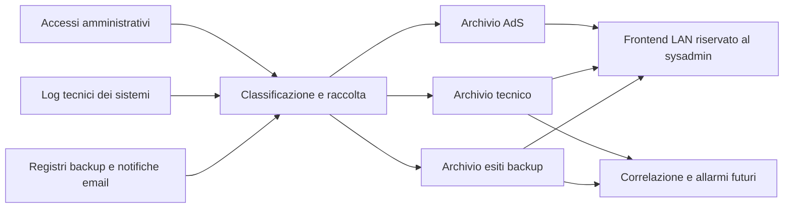

# Raccolta dei log operativi e delle notifiche email

Decisione dell'utente del 13/10/2026: usare la VM esistente per raccogliere anche log tecnici ed esiti dei backup, consultabili in seguito da un frontend riservato al sysadmin. La correlazione e gli allarmi di tipo SIEM sono una fase successiva. Questo documento registra progetto e stato del censimento: al 14/10 due originali Seeweb sono stati letti dalla postazione e un lettore locale è verificato; nessun nuovo servizio è installato sulla VM. Il dettaglio delle misure è in docs/runbook-log-operativi-email.md.

## Tre categorie nella stessa VM

| Archivio logico | Contenuto | Stato |
|---|---|---|
| Accessi AdS | Autenticazioni amministrative e prova della raccolta, con elenco approvato e custodia previsti dal progetto | Raccolta parziale in esercizio; D7 e catena completa ancora aperti |
| Log tecnici e operativi | Apparati, sistemi, applicazioni e accessi ordinari NAS classificati separatamente | Flusso tecnico iLO già separato; nuove sorgenti e smistamento NAS da realizzare |
| Esiti dei backup | Report di job, warning, errori, restore e mancata esecuzione, da registri diretti o email | Due report Seeweb e sei stati per unità verificati localmente; raccolta in produzione ancora da definire |

Le tre categorie sono serbatoi logici; percorsi, quote, utenti di servizio e retention dei nuovi flussi si definiranno sullo stato della VM. Un report tecnico di backup non entra nella catena probatoria AdS. La stessa mail può contenere più job o eventi e non deve diventare una sola riuscita generica. Gli accessi ordinari NAS mantengono classificazione e autorizzazioni proprie anche se collocati nel secondo archivio.

## Censimento della posta autorizzato

L'utente autorizza il controllo delle notifiche automatiche ricevute dalla casella IT e delle copie recapitate a due caselle personali IT. Indirizzi reali in `_notes/mail-log-scope.json`, ignorato da git. Si ricogniscono report e log automatici pertinenti all'infrastruttura; la normale corrispondenza commerciale non è una sorgente di log da importare.

Partire dal periodo recente e dagli archivi/cartelle delle notifiche, includendo report giornalieri, settimanali e mensili. Per ciascuna famiglia annotare sorgente e prodotto, mittente effettivo e intestazioni, casella/cartella, esemplari di successo e fallimento disponibili, oggetto, formato del corpo/allegato, job o nodo, tempi/fuso, esito, cadenza attesa e link al registro autorevole. Riportare anche risultati parziali e limite temporale della ricerca; assenza in una cartella o pagina non dimostra assenza del servizio.

Confrontare le copie nelle tre caselle prima di decidere il canale di produzione. `Message-ID`, identificativo del job, ora dichiarata e impronta del contenuto sono candidati per il confronto, da verificare sugli originali: un inoltro può cambiare le intestazioni e due run possono avere lo stesso oggetto. Conservare privatamente originale e ora di acquisizione; non dedurre l'autenticità o l'esito dal solo campo From.

La scoperta comprende Seeweb, NAS/HBS, Proxmox, Veeam, Cobian, esportazioni TM, hosting/WordPress e altri report effettivamente presenti, secondo `docs/ricognizione-servizi-e-backup.md`. Non presumere che ogni prodotto mandi email. Il registro diretto è da valutare come sorgente primaria; la mail può essere un'alternativa o una notifica da collegare al medesimo evento.

## Accesso attuale alla posta

Il 13/10 la sessione non espone strumenti di lettura Outlook. La ricerca delle integrazioni trova **Outlook Email disponibile e non installato**; proposta l'installazione/connessione, senza considerarla eseguita. Sul PC è rilevato il nuovo Outlook, non il processo Outlook classico; questo non fornisce da solo accesso ai messaggi dell'account. Il 14/10 sono invece letti due originali esportati dall'operatore: questo permette il campionamento del formato, senza un censimento completo delle caselle o una connessione di servizio. Non sono state usate credenziali del Word, lette cache di token o create regole di inoltro.

## Report Seeweb acquisiti e lettore locale, 14/10/2026

Due originali provenienti dalla casella IT condivisa, confermata dall'operatore: report del 12/10 con tre unità OK e del 13/10 con due Error e una OK. Una mail non equivale a un job: i sei record sono stati dichiarati per unità di consumo, con Date/Received distinti dall'acquisizione e job_execution_time null. Job, orario effettivo, causa e stato attuale del 14/10 richiedono pannello o report ulteriori. Zero allegati; HTML UTF-8/base64 e due tabelle con nove colonne per unità.

Lettore locale tools/read-seeweb-report.py verificato sulle nove colonne di tutte le unità e con 24 prove automatiche, due mutazioni rilevate e ripristinate. Conserva originali/SHA e manifest privati; rifiuta schema/conteggi incoerenti. Deduplica soltanto byte identici; altre copie con lo stesso Message-ID e contenuto rimangono candidati. Prossimo campione discriminante: originale .eml della copia già ricevuta del report Error del 13/10 in una casella personale IT autorizzata, con casella dichiarata. Nessun nuovo inoltro manuale. Fonti, misure, SHA e limiti in docs/runbook-log-operativi-email.md.

## Avvio del censimento Seeweb, 13/10/2026

Dopo la chiusura della milestone Nebula in abd1ea4, l'utente rimanda esplicitamente il test degli accessi AdS offline e chiede di procedere con altro. Il censimento delle notifiche IT e dei backup diventa il lavoro corrente; il rinvio lascia aperto il gate offline prima dell'installazione del poller. Nessuna regola del firewall o interruzione del collegamento cloud è stata eseguita.

La verifica delle integrazioni delle 17:32:59 locali riconferma Outlook Email disponibile e non installato, senza strumenti di lettura della posta. Il suggerimento delle 10:02:34 locali è già presente e non viene riproposto. Esito e cronologia in _notes/email-connector-check-20261013.json; zero messaggi letti. Questa verifica riguarda l'integrazione della sessione, non l'accessibilità delle singole caselle Microsoft né la loro configurazione.

Primo campione: un report Seeweb originale recente, esportato in formato .eml e salvato in _notes/email-reports-inbox, ignorato da git. Nel nuovo Outlook il messaggio aperto si salva da Altre azioni > Salva con nome, secondo la [procedura ufficiale Microsoft](https://support.microsoft.com/it-it/outlook/mail/save-an-outlook-message-as-a-eml-file-a-pdf-file-or-as-a-draft). Il file originale conserva intestazioni, corpo e allegati utili al confronto; un PDF o una schermata non costituiscono lo stesso campione. Il salvataggio locale non configura inoltri né un nuovo flusso sul collettore.

Per ogni campione si conserveranno privatamente byte originali, SHA-256, ora di acquisizione e casella di provenienza, distinguendo Date e Received dall'ora del job. Si leggeranno mittente effettivo, Message-ID, oggetto, struttura MIME, corpo e allegati, senza dedurre un esito dal mittente o dall'oggetto. Il primo report può contenere più nodi, job o stati: numero di mail e numero di backup restano contatori separati. La cadenza attesa, la deduplicazione fra le copie e la corrispondenza col pannello richiedono poi ulteriori campioni. In quel giro non viene implementato un parser Seeweb né dichiarato un export supportato del prodotto; il lettore locale preparato sui campioni successivi è descritto nel runbook.

## Pannelli e audit Seeweb oltre alle mail

Il censimento del 14/10 comprende anche i sette punti di accesso forniti dall'operatore, descritti in docs/sorgenti-log-seeweb.md. Il lettore email è locale e versionato in a5fe489; non raccoglie login del portale backup, Cloud Center, hypervisor, appliance, area clienti o supporto. Audit del provider, eventi tecnici dei sistemi e report backup hanno canali e prove distinti. Il Word e tre schermate completano l'attribuzione; nessun accesso ai pannelli o flusso sulla VM è stato attivato. La raccolta consentita va verificata per prodotto/versione e ruolo del tenant.

## Gate prima dell'ingestione

Occorrono campioni reali e confronto delle copie, canale supportato con permessi minimi, credenziale propria del servizio, parser per i formati osservati, coda persistente, deduplicazione, gestione degli errori e degli allegati, controllo dei report mancanti e limiti di volume. Mail arrivata, job completato e copia ripristinabile sono fatti diversi: il controllo del silenzio non sostituisce la prova di restore. Destinatari tecnici, retention e permessi dei due nuovi archivi restano da definire; la notifica alla Direzione continua a riguardare il flusso AdS.

La consultazione web segue ADR-017: LAN, autenticazione nominativa del solo sysadmin autorizzato, TLS, sola lettura e audit della consultazione. Il frontend non conferisce al lettore la custodia della prova dei propri accessi. Correlazioni e allarmi si progettano dopo una raccolta verificata; nessuna completezza SIEM è dichiarata per un inventario o per un insieme di email.

## Monitoraggio Linux e host Ollama, 15/10/2026

Studio e piano in [Osservabilità Linux](osservabilita-linux-netdata.md): console e database per le metriche, eventi originali e allarmi nell’archivio tecnico, accessi AdS con i gate esistenti. Scelta locale senza abbonamenti ricevuta: Netdata Agent, Prometheus e Grafana OSS, più Loki/Alloy per i file tecnici. Agent 2.12.1 attivo sul fisico pilota con loopback e CPU/RAM verificati; GPU, dimensionamento e inoltro al collettore ancora aperti. [Normalizzazione e capienza](normalizzazione-retention-capienza.md) definisce contratto comune, politiche e guardie proposte; [Fonti e passi](fonti-osservabilita-linux.md) collega le evidenze.
