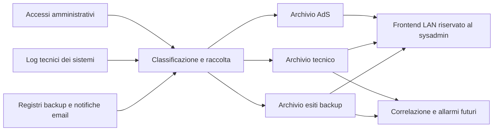

# Raccolta dei log operativi e delle notifiche email

Decisione dell'utente del 13/10/2026: usare la VM esistente per raccogliere anche log tecnici ed esiti dei backup, consultabili in seguito da un frontend riservato al sysadmin. La correlazione e gli allarmi di tipo SIEM sono una fase successiva. Questo documento registra il progetto e il censimento da eseguire; nessun servizio nuovo è installato e nessuna email è stata letta o inoltrata da questa sessione.

## Tre categorie nella stessa VM

| Archivio logico | Contenuto | Stato |
|---|---|---|
| Accessi AdS | Autenticazioni amministrative e prova della raccolta, con elenco approvato e custodia previsti dal progetto | Raccolta parziale in esercizio; D7 e catena completa ancora aperti |
| Log tecnici e operativi | Apparati, sistemi, applicazioni e accessi ordinari NAS classificati separatamente | Flusso tecnico iLO già separato; nuove sorgenti e smistamento NAS da realizzare |
| Esiti dei backup | Report di job, warning, errori, restore e mancata esecuzione, da registri diretti o email | Richiesto dall'utente, censimento e canali da verificare |

Le tre categorie sono serbatoi logici; percorsi, quote, utenti di servizio e retention dei nuovi flussi si definiranno sullo stato della VM. Un report tecnico di backup non entra nella catena probatoria AdS. La stessa mail può contenere più job o eventi e non deve diventare una sola riuscita generica. Gli accessi ordinari NAS mantengono classificazione e autorizzazioni proprie anche se collocati nel secondo archivio.

## Censimento della posta autorizzato

L'utente autorizza il controllo delle notifiche automatiche ricevute dalla casella IT e delle copie recapitate a due caselle personali IT. Indirizzi reali in `_notes/mail-log-scope.json`, ignorato da git. Si ricogniscono report e log automatici pertinenti all'infrastruttura; la normale corrispondenza commerciale non è una sorgente di log da importare.

Partire dal periodo recente e dagli archivi/cartelle delle notifiche, includendo report giornalieri, settimanali e mensili. Per ciascuna famiglia annotare sorgente e prodotto, mittente effettivo e intestazioni, casella/cartella, esemplari di successo e fallimento disponibili, oggetto, formato del corpo/allegato, job o nodo, tempi/fuso, esito, cadenza attesa e link al registro autorevole. Riportare anche risultati parziali e limite temporale della ricerca; assenza in una cartella o pagina non dimostra assenza del servizio.

Confrontare le copie nelle tre caselle prima di decidere il canale di produzione. `Message-ID`, identificativo del job, ora dichiarata e impronta del contenuto sono candidati per il confronto, da verificare sugli originali: un inoltro può cambiare le intestazioni e due run possono avere lo stesso oggetto. Conservare privatamente originale e ora di acquisizione; non dedurre l'autenticità o l'esito dal solo campo From.

La scoperta comprende Seeweb, NAS/HBS, Proxmox, Veeam, Cobian, esportazioni TM, hosting/WordPress e altri report effettivamente presenti, secondo `docs/ricognizione-servizi-e-backup.md`. Non presumere che ogni prodotto mandi email. Il registro diretto è da valutare come sorgente primaria; la mail può essere un'alternativa o una notifica da collegare al medesimo evento.

## Accesso attuale alla posta

Il 13/10 la sessione non espone strumenti di lettura Outlook. La ricerca delle integrazioni trova **Outlook Email disponibile e non installato**; proposta l'installazione/connessione, senza considerarla eseguita. Sul PC è rilevato il nuovo Outlook, non il processo Outlook classico; questo non fornisce da solo accesso ai messaggi dell'account. La lettura resta attesa finché un collegamento autorizzato o originali esportati permettono di esaminare i report. Non sono state usate credenziali del Word, lette cache di token o create regole di inoltro.

## Gate prima dell'ingestione

Occorrono campioni reali e confronto delle copie, canale supportato con permessi minimi, credenziale propria del servizio, parser per i formati osservati, coda persistente, deduplicazione, gestione degli errori e degli allegati, controllo dei report mancanti e limiti di volume. Mail arrivata, job completato e copia ripristinabile sono fatti diversi: il controllo del silenzio non sostituisce la prova di restore. Destinatari tecnici, retention e permessi dei due nuovi archivi restano da definire; la notifica alla Direzione continua a riguardare il flusso AdS.

La consultazione web segue ADR-017: LAN, autenticazione nominativa del solo sysadmin autorizzato, TLS, sola lettura e audit della consultazione. Il frontend non conferisce al lettore la custodia della prova dei propri accessi. Correlazioni e allarmi si progettano dopo una raccolta verificata; nessuna completezza SIEM è dichiarata per un inventario o per un insieme di email.
